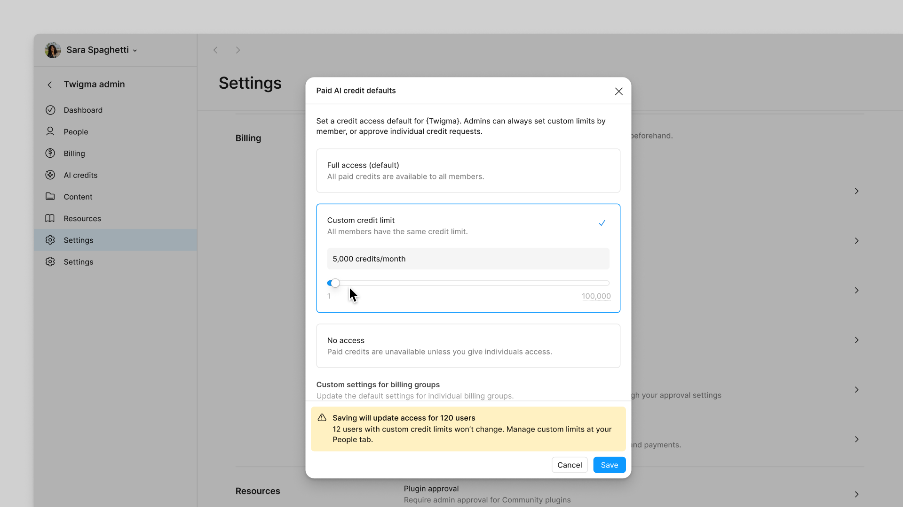
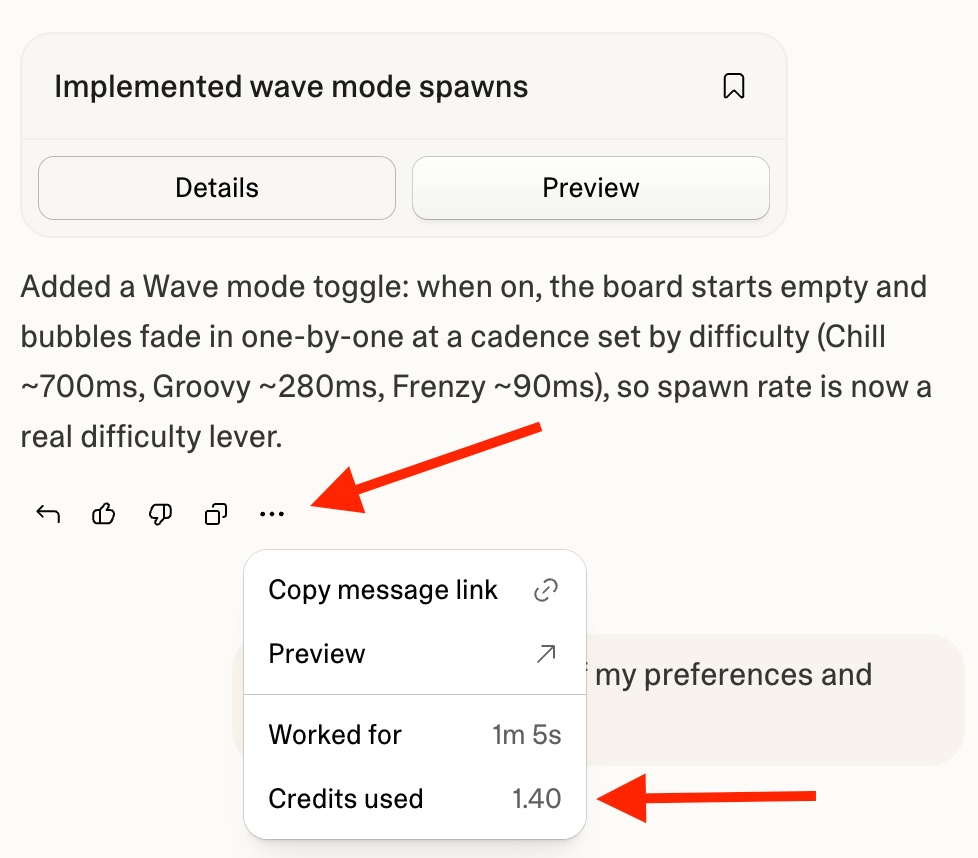
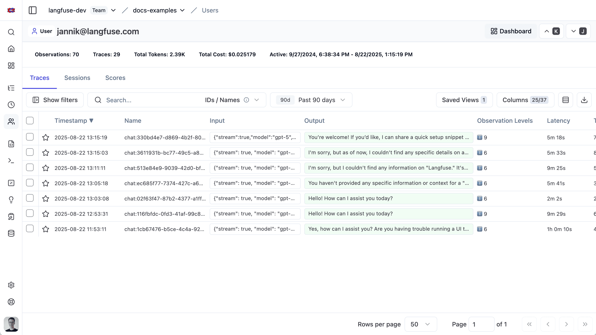

# Worked example: controlling shared AI spend

This is a historical application of the methodology, researched on 30 October 2026. It illustrates reasoning, not current vendor guarantees. Verify sources and plan restrictions for a new assignment. The original brief concerned one person exhausting shared credits, difficulty identifying spend by member/project, and the need to contain unnecessary consumption.

## Job and cohort

**Job:** When shared AI credits drain unexpectedly, help an admin explain consumption and contain the cause so colleagues can continue useful work.

Assumption: the target product has shared organization credits, multiple members and identifiable projects. The target product was unnamed, so “direct” describes functional relevance rather than a confirmed competitive relationship.

| Reference role | Product | Reason to study |
|---|---|---|
| Close functional reference | Lovable | Shared credits, member/project accountability and scoped usage rules. |
| Enterprise expectations | Microsoft Copilot Credits | Policy scope, organization-level administration and credit requests. |
| Adjacent admin pattern | Figma AI | Seat entitlements versus additional paid credits, member settings and defaults. |
| Diagnostic analogue | Langfuse | User-to-trace cost investigation in instrumented applications. |

The original broad inventory contained 14 products. Its coverage remained available; the four references formed the strategic argument.

## Evidence to implications

### A limit does not necessarily reserve capacity

**Documented behavior:** Figma's individual paid-credit cap does not reserve credits for that person. Personal caps and the shared pool can independently constrain access. [Official limit documentation](https://help.figma.com/hc/en-us/articles/41944442159767-Set-AI-credit-limits).

**Interpretation:** limiting one person's spending and guaranteeing everyone capacity are different promises. The vendor's motive is unknown.

**Product implication:** choose whether to provide cost containment, flexible sharing or protected capacity. Do not imply fairness guarantees from caps alone.

**Design implication:** label a cap as a maximum; explain the governing pool and rule. Preview affected members and untouched overrides before changing a default.

**Action/check:** test whether an admin can correctly explain why someone below their cap could still be blocked. Research protected capacity only if critical-work continuity justifies its tradeoffs.

**Annotation:** entry point—paid-credit defaults; useful pattern—access choices and impact review together; friction hypothesis—admins may assume changing the default changes custom overrides; proposed response—show changed and unchanged members explicitly. The screenshot is static evidence, not a tested walkthrough.

### Explain the work before restricting the person

**Screen evidence:** Lovable exposes credits consumed in a response menu. Its published usage guidance also describes activity and project investigation. [Official usage documentation](https://docs.lovable.dev/introduction/credits-and-usage).

**Product implication:** reliable attribution and enough explanatory detail belong before advanced optimization. High consumption may be productive.

**Design implication:** connect an expensive action to the responsible member/project, selected period and applicable rule.

**Action/check:** compare a useful heavy task with a runaway case in a scenario test. Observe whether the admin identifies the correct driver without exporting data.

**Annotation:** entry point—response menu; useful pattern—cost beside the work; unverified handoff—whether the admin can continue directly into the right policy; proposed response—preserve entity and period through the investigation.

### Diagnosis needs a path into underlying activity

**Documented behavior:** Langfuse supports user tracking and underlying traces; costs may be supplied or inferred. [User tracking](https://langfuse.com/docs/observability/features/users), [cost tracking](https://langfuse.com/docs/observability/features/token-and-cost-tracking).

**Product implication:** define identity and cost provenance before promising accurate attribution. Reporting is not proof of request-blocking enforcement.

**Design implication:** carry the person into their history, then let the admin inspect expensive actions. Start with useful work context and progressively reveal technical details.

**Annotation:** entry point—individual user detail; useful pattern—aggregate context with trace history; friction hypothesis—technical traces may overwhelm workspace admins; proposed response—plain-language session summaries with optional diagnostics.

## Default investigation

The historical investigation verified these examples:

- Lovable new rules began with blocking and email enabled; temporary increase approval preselected the period's end. [Rule documentation](https://docs.lovable.dev/features/usage-limits-and-alerts).
- Microsoft policy setup selected All users and Auto-apply new services by default. [Policy documentation](https://learn.microsoft.com/en-us/microsoft-365/copilot/usage-based-billing-manage-copilot-credits).
- Figma custom member limits survived an organization-default change. Its documented default-setting options identified Full access as the default. [Default documentation](https://help.figma.com/hc/en-us/articles/41944442159767-Set-AI-credit-limits).

These describe settings, not proven vendor intent or architecture. The recommendation was an explicit scope/impact preview and expiring exceptions, not blindly copying each default.

## Insight to action

**Counter-strategy:** match attribution and scoped controls; differentiate through explainable intervention that protects useful work continuing.

| Insight | Product action | Design action | Validation / priority |
|---|---|---|---|
| Shared totals hide accountability | Define member/project attribution and unknown usage | Linked trend, ranked entities and activity detail | Identify the responsible entity without exporting. First. |
| Caps, alerts and allocations differ | Specify enforcement, precedence, reset and overshoot | Effective-rule and impact preview | Correctly predict who stops and who remains unaffected. First. |
| Blocking creates a recovery job | Define reviewer, status and expiry | Context-preserving request and temporary increase | Observe blocked time and approval turnaround. First. |
| Fair access is not guaranteed by caps | Research protected capacity and its economic tradeoffs | Compare shared and reserved-capacity scenarios | Validate critical-work continuity without excessive idle capacity. Next hypothesis. |

No original prospect interviews, systematic review sample, scored usability audit or controlled outcome study was performed. Proposed support, retention, savings and task-time benefits remained hypotheses. Numeric targets required a baseline.

## Presentation example

Open [the complete historical HTML presentation](../assets/ai-spend-example.html) for the finished layout. It includes the four-reference reasoning, detailed investigation, annotated screen references, recommendations, broader feature tables and horizontal product galleries. Its embedded screenshots and dated facts are example evidence; replace or reverify them for new work. See [presentation-layout.md](presentation-layout.md) for the reusable structure and deck adaptation.
